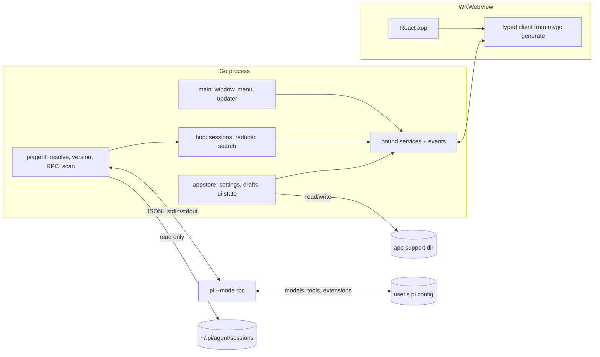
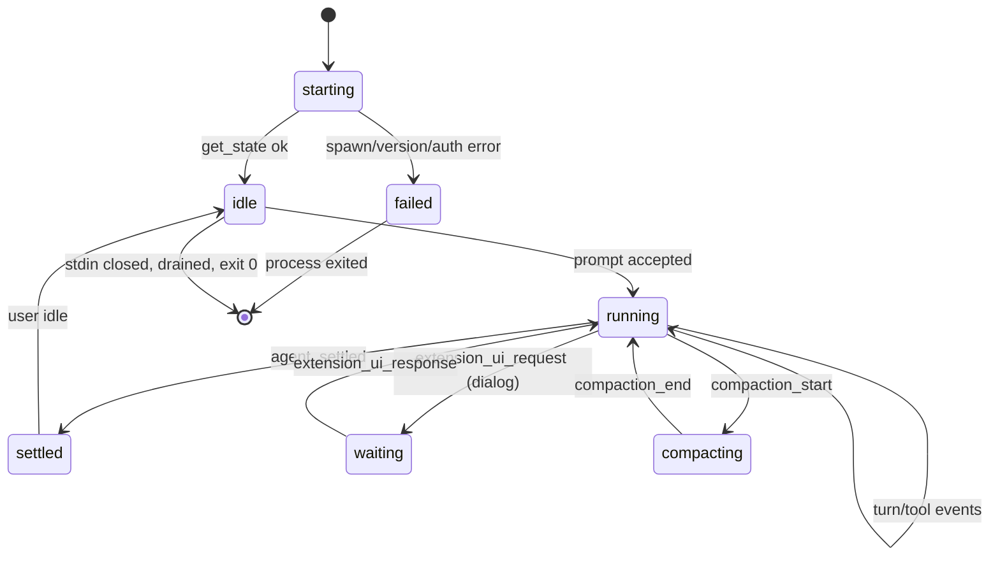

# Architecture

## Shape

One Go binary, one window, one embedded React app. The Go side owns every pi
process and every piece of durable state; the webview is a renderer with a
narrow, typed API. Reloading the webview (dev HMR, or ⌘R) loses nothing.



Non-negotiable invariants:

1. The app never writes pi's session files, credentials or settings. Session
   mutations go through RPC commands or `pi` CLI invocations.
2. At most one pi process per session file, enforced by the hub.
3. The webview never sees raw pi JSONL. It receives normalised snapshots and
   ordered patches, so the same reducer can be unit-tested in Go.
4. Every text delta is either delivered or superseded by a snapshot. Text is
   never dropped to save bandwidth, and never delivered out of order.

## Go packages

```text
main.go                     app wiring: window, menu, tray?, updater, deep links
internal/piagent/
  resolve.go                pi executable lookup: PI_EXECUTABLE, PATH, login shell
  version.go                --version parse, MIN_PI/TESTED_PI gate
  rpc.go                    child process, LF framing, request correlation
  events.go                 pi session event structs (subset we consume)
  auth.go                   pi auth check --json, provider readiness
  models.go                 pi --list-models parsing
  sessions.go               session directory scan, headers, caching
  bridge.ts                 optional pi extension (only if a gap appears)
internal/hub/
  hub.go                    open/close sessions, process ownership, limits
  session.go                per-session state: transcript, run state, queues
  reduce.go                 pi events -> normalised entries (pure, testable)
  patch.go                  delta coalescing, sequence numbers
  search.go                 per-session text index and match offsets
  errors.go                 pi/provider error classification
internal/appstore/
  settings.go               atomic JSON read/write, schema version
  drafts.go                 per-session drafts and scroll anchors
internal/api/
  services.go               bound services the frontend may call
  events.go                 mygo.NewEvent declarations
locales/*.toml              en, zh-Hans catalogs
```

Packages point one way: `api → hub → piagent`, `api → appstore`. `piagent` has
no knowledge of the UI, `hub` has no knowledge of mygo, `api` holds no logic
beyond validation and conversion.

## Frontend layout

```text
src/
  app/            shell: window chrome, sidebar, routing, providers
  features/
    sessions/     project + session lists, rename, delete, export
    transcript/   virtual list, entries, markdown, code, diff, tool cards
    composer/     editor, attachments, slash menu, @files, send/steer/queue
    tree/         session tree drawer
    settings/     four settings groups
    search/       ⌘F overlay and highlight plumbing
  components/ui/  shadcn primitives, themed
  lib/            store, ipc client, i18n, formatting, keybindings
  styles/         tokens.css, typography.css
```

State: one zustand store per session (keyed by id) plus an app store. Server
state lives in Go; the store is a cache with a `seq` watermark, replaced wholesale
by a snapshot on reconnect.

## Process and run state



Rules:

- `agent_end` is not the end of work; only `agent_settled` is.
- A `prompt` response with `disposition: "handled"` starts no run; do not wait.
- Steering and follow-up queues are mirrored from `queue_update`, which always
  carries the *complete* queue.
- If the child exits unexpectedly, the session becomes `failed` with exit code
  and the last 20 stderr lines. "Reopen" starts a new process with
  `--session <file>`; it never replays the last prompt.
- Closing stdin is the shutdown request; stdout stays drained until exit. Killing
  the pipe first makes pi crash with EPIPE (verified).

## Two-way protocol

Go → web: `SessionSnapshot` on subscribe, then `SessionPatch` messages with a
monotonic `seq`. Patch ops are minimal and typed:

```ts
type Patch =
  | { op: "entry.add"; entry: Entry }
  | { op: "entry.text"; id: string; block: number; delta: string }
  | { op: "entry.final"; id: string; entry: Entry }
  | { op: "status"; status: Status; run?: RunInfo }
  | { op: "queue"; steering: string[]; followUp: string[] }
  | { op: "usage"; usage: Usage; context?: ContextUsage }
  | { op: "notice"; level: "info" | "warn" | "error"; text: string }
```

Web → Go: bound methods only, all returning `(value, error)`:

```text
App.info()                     version, pi path/version, compat, platform
Projects.list()                discovered projects with sessions
Sessions.open(id)              -> snapshot
Sessions.new(cwd)              -> snapshot
Sessions.close(id, stop bool)
Sessions.rename(id, name)
Sessions.delete(id)
Sessions.export(id)            -> html path
Sessions.tree(id)
Sessions.fork(id, entryId)
Sessions.clone(id)
Sessions.search(id, query)     -> matches[{entryId, offset, length}]
Prompt.send(id, text, images, mode)   mode: send | steer | followUp
Prompt.abort(id)
Prompt.clearQueue(id)
Model.set(id, provider, modelId)
Model.thinking(id, level)
Session.compact(id, instructions?)
ExtSettings.status(id)         last status text per extension key (ANSI stripped)
Files.list(cwd, query)         for @-completion, bounded depth
Settings.get() / Settings.set(patch)
```

Validation at the boundary: session ids are looked up in the hub, never used to
build paths. File paths from drops are resolved and checked to exist before being
inserted as text.

## Event reduction

`reduce.go` is the only place that understands pi's event vocabulary. It is pure:
`Reduce(state, event) -> []Patch`. A recorded session fixture replays through it
in tests.

Entry kinds: `user`, `assistant`, `thinking`, `tool`, `error`, `compaction`,
`notice`. Blocks inside an entry: `text`, `image`, `toolCall`, `toolResult`,
`diff`.

Tool results are matched by `toolCallId`, not by position. A tool whose result
never arrives stays `running` and is marked `interrupted` on `agent_settled`.

## Failure handling

| Failure | Detection | UI |
| --- | --- | --- |
| pi missing | resolve fails | blocking first-run card with install command |
| pi too old/new | `--version` gate | sidebar banner, sending disabled, explanation |
| not signed in | `pi auth check --json` or provider error | error card with "Sign in" action |
| provider 429/5xx | error text + retry events | error card with "Retry", auto-retry countdown |
| context overflow | compaction failure / provider error | error card with "Compact" action |
| unknown model | `set_model` failure | model picker stays open, inline message |
| tool failure | `tool_execution_end.isError` | tool card expands, error styling |
| process crash | `cmd.Wait` exit | session banner, "Reopen" action, stderr folded |

`pi` extension status text arrives with ANSI escapes; it is stripped before it
reaches the UI. Unsupported extension UI methods (`setWidget`, `custom`) are
acknowledged and ignored in v0.1, and the ignored count is visible in
diagnostics rather than silently swallowed.

## Performance budgets

| Path | Budget |
| --- | --- |
| Cold start to first paint | < 500 ms |
| Idle RSS with one session | < 120 MB |
| Streaming patch application | < 8 ms per frame at 60 fps |
| Open a 20k-message session | < 1 s, list usable immediately |
| Session list scan (1k files, warm) | < 50 ms |
| Search across a 20k-message session | < 150 ms |

Implementation notes: deltas coalesce on a 16 ms tick before crossing the IPC
boundary; transcript rows are virtualised with a stable id per entry; markdown is
chunked at block boundaries so only the last block re-parses; Shiki grammars load
per language on demand; animations use transform/opacity only.
